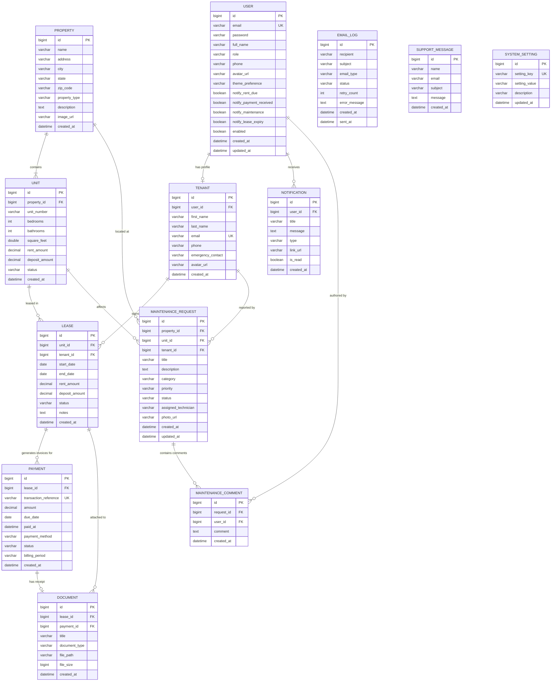
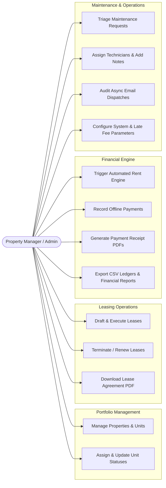
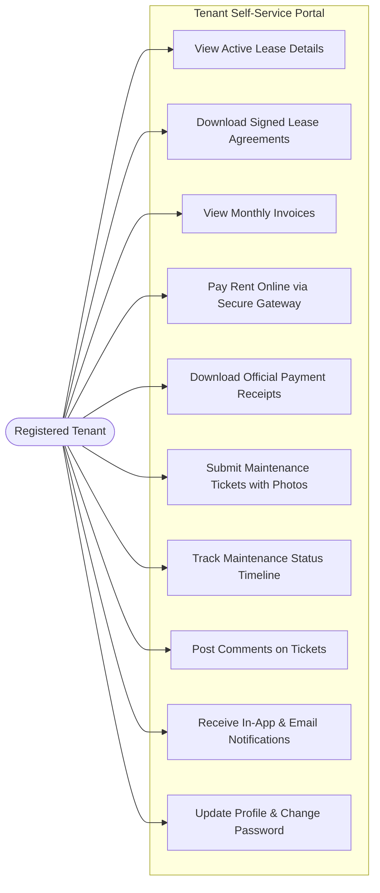

# Propio System Architecture, Diagrams & Java Feature Catalog

This document contains the official architectural design documentation for **Propio**, including Mermaid Entity-Relationship (ER) diagrams, Use Case diagrams, Class architecture diagrams, and a comprehensive mapping of Java enterprise features to class implementations.

---

## 1. Entity-Relationship (ER) Diagram

---

## 2. Use Case Diagrams

### Admin & Property Manager Use Cases

### Tenant Portal Use Cases

---

## 3. High-Level Class & Component Architecture

```mermaid
classDiagram
    class SecurityConfig {
        +SecurityFilterChain filterChain(HttpSecurity)
        +PasswordEncoder passwordEncoder()
    }

    class CustomUserDetailsService {
        +loadUserByUsername(String email) UserDetails
    }

    class LoginAttemptService {
        +loginSucceeded(String key)
        +loginFailed(String key)
        +isBlocked(String key) boolean
        +getRemainingLockoutMinutes(String key) int
    }

    class PaymentService {
        +runRentEngine() BillingSummaryDto
        +recordPayment(PaymentRecordDto) Payment
        +processOnlinePayment(Long id, CardDto) Payment
    }

    class PdfGenerationService {
        +generatePaymentReceiptPdf(Payment) byte[]
        +generateLeaseAgreementPdf(Lease) byte[]
        +generateTenantStatementPdf(Tenant, int year) byte[]
        +generateFinancialReportPdf(ReportDto) byte[]
    }

    class EmailService {
        +sendRentDueNotification(Lease, Payment)
        +sendPaymentReceivedWithReceipt(Payment, byte[])
        +sendMaintenanceStatusUpdate(MaintenanceRequest)
        +sendWelcomeEmail(User, String tempPassword)
        +resendEmail(Long emailLogId)
    }

    class MaintenanceService {
        +createRequest(Tenant, MaintenanceDto) MaintenanceRequest
        +updateStatus(Long id, RequestStatus, String note) MaintenanceRequest
        +assignTechnician(Long id, String techName) MaintenanceRequest
        +addComment(Long id, User author, String text) MaintenanceComment
    }

    class ReportService {
        +getDashboardMetrics() DashboardMetricsDto
        +getRevenueChartData(LocalDate from, LocalDate to) ChartDataDto
        +exportPaymentsCsv(LocalDate from, LocalDate to) String
    }

    SecurityConfig --> CustomUserDetailsService : configures
    SecurityConfig --> LoginAttemptService : invokes on failure/success
    PaymentService --> PdfGenerationService : generates receipts
    PaymentService --> EmailService : dispatches receipt emails
    MaintenanceService --> EmailService : dispatches ticket updates
```

---

## 4. Java Features & Class Mapping Catalog

Below is the exhaustive catalog of Java 17 and Spring Boot enterprise features implemented across Propio, with exact package paths and class names.

### A. Core Architecture & Dependency Injection
| Capability / Design Pattern | Spring / Java Feature | Implementation Classes |
| :--- | :--- | :--- |
| **Inversion of Control (IoC)** | `@Service`, `@Component`, `@Configuration`, Constructor Injection | All classes in `com.propio.service`, `com.propio.config` |
| **Boilerplate Reduction** | Lombok (`@Getter`, `@Setter`, `@Builder`, `@RequiredArgsConstructor`, `@Slf4j`) | All Models in `com.propio.model`, Services, DTOs |
| **Declarative Transactions** | Spring `@Transactional` (with read-only optimizations) | `PaymentService`, `LeaseService`, `MaintenanceService`, `UserService` |
| **REST & MVC Controllers** | `@Controller`, `@RestController`, `@GetMapping`, `@PostMapping` | All classes in `com.propio.controller` |

### B. Security & Authentication
| Security Feature | Implementation Mechanism | Class Names |
| :--- | :--- | :--- |
| **Role-Based Authorization** | `hasRole('ADMIN')`, `hasAnyRole('ADMIN', 'TENANT')`, `@EnableMethodSecurity` | `com.propio.config.SecurityConfig` |
| **Password Hashing** | Spring `BCryptPasswordEncoder` (cost factor 10) | `SecurityConfig`, `UserService`, `DataSeeder` |
| **Password Complexity Policy** | Jakarta `@Pattern` (Regex for min 8 chars, uppercase, lowercase, digit) | `com.propio.dto.RegisterDto`, `com.propio.dto.ChangePasswordDto`, `UserService` |
| **Brute-Force Rate Limiting** | Concurrent in-memory tracking, 5-attempt limit, 15-minute temporary lockout | `com.propio.service.LoginAttemptService` |
| **Custom Auth Handlers** | `SimpleUrlAuthenticationFailureHandler`, `SavedRequestAwareAuthenticationSuccessHandler` | `com.propio.config.CustomAuthenticationFailureHandler`, `CustomAuthenticationSuccessHandler` |
| **Tenant Isolation Engine** | Service-layer checks comparing authenticated tenant ID with resource owner | `PaymentService`, `LeaseService`, `MaintenanceService`, `DocumentController` |
| **Security Headers** | CSP directives, HSTS (31536000s), FrameOptions (SAMEORIGIN), ReferrerPolicy | `com.propio.config.SecurityConfig` |
| **CSRF Defense** | Form tokens & AJAX CSRF request token verification | Standard Spring Security Filter Chain |

### C. Financial & Billing Engine
| Feature | Implementation Mechanism | Class Names |
| :--- | :--- | :--- |
| **Exact Money Precision** | `java.math.BigDecimal` (arithmetic with `RoundingMode.HALF_UP`) | `Payment`, `Lease`, `Unit`, `PaymentService`, `ReportService` |
| **Automated Rent Engine** | Spring `@Scheduled(cron = "0 0 1 1 * ?")` with manual on-demand trigger | `com.propio.service.PaymentService`, `com.propio.controller.PaymentController` |
| **Billing Idempotency** | Checks existing invoices for given `leaseId` and `billingPeriod` to eliminate duplicates | `com.propio.repository.PaymentRepository`, `PaymentService` |
| **Late Fee Rule Application**| Calculates percentage charge after due date grace period expires | `PaymentService`, `SystemSettingService` |

### D. PDF Document Generation
| Feature | Implementation Mechanism | Class Names |
| :--- | :--- | :--- |
| **Payment Receipt PDF** | OpenPDF (`Document`, `PdfWriter`, `PdfPTable`, custom headers, PAID stamp) | `com.propio.service.PdfGenerationService`, `PdfDownloadController` |
| **Lease Agreement PDF** | OpenPDF multi-page legal agreement with signature blocks and terms | `com.propio.service.PdfGenerationService`, `PdfDownloadController` |
| **Yearly Statement PDF** | OpenPDF tabular ledger showing 12-month tenant transaction history | `com.propio.service.PdfGenerationService`, `PdfDownloadController` |
| **Financial Summary PDF** | OpenPDF executive overview of portfolio collections, revenues, and arrears | `com.propio.service.PdfGenerationService`, `ReportController` |

### E. Asynchronous Processing & Email Dispatch
| Feature | Implementation Mechanism | Class Names |
| :--- | :--- | :--- |
| **Non-blocking Execution** | Spring `@Async` thread pool task executors | `com.propio.service.EmailService` |
| **HTML Email Templating** | Thymeleaf `SpringTemplateEngine` evaluating HTML layouts with model attributes | `com.propio.service.EmailService`, `templates/mail/*` |
| **Attachment Handling** | Spring `MimeMessageHelper` with `ByteArrayResource` attachment streaming | `com.propio.service.EmailService` |
| **Safe Dev Fallback** | `propio.mail.enabled` check; logs styled payload when SMTP is offline | `com.propio.service.EmailService` |
| **Email Audit & Resend** | JPA persistence in `EmailLog` table; admin retry handler | `com.propio.repository.EmailLogRepository`, `com.propio.controller.EmailController` |

### F. Health Checks & Observability
| Feature | Implementation Mechanism | Class Names |
| :--- | :--- | :--- |
| **Actuator Liveness/Readiness**| Standard JSON health response querying `DataSource.getConnection().isValid(2)` | `com.propio.controller.ActuatorHealthController` |
| **Zero Stacktrace Leakage**| Spring Boot `server.error.include-stacktrace=never`, custom 404/403/500 templates | `com.propio.controller.CustomErrorController`, `application-prod.properties` |
| **Structured Logging** | SLF4J with Logback; level segregation (`INFO` for app, `WARN` for framework) | `logback-spring.xml` / `application-prod.properties` |
